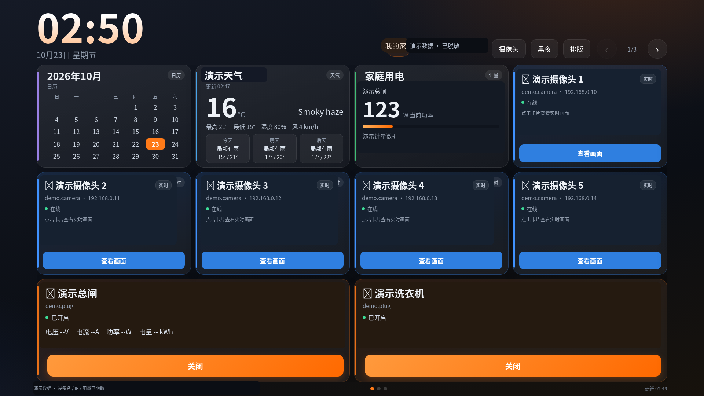
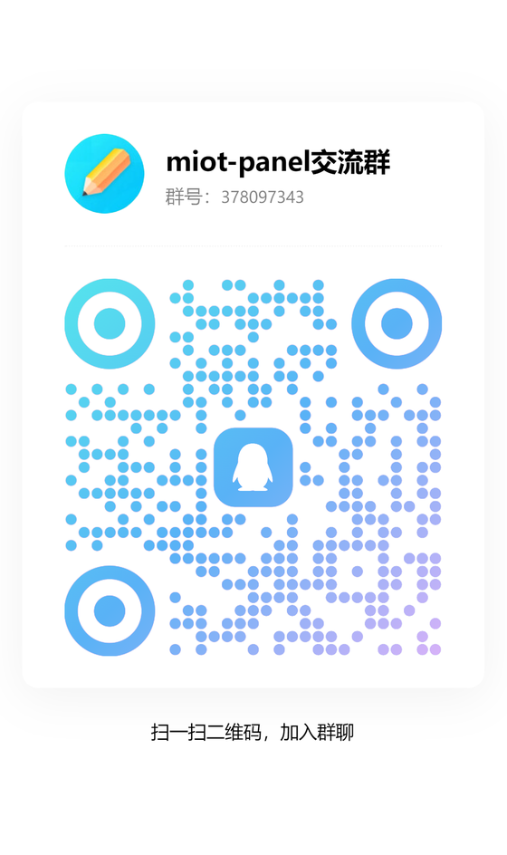

# 米家云端面板（miot-cloud）

一个可移植的米家 / 小米智能家居触屏面板。登录小米账号后从云端枚举设备，直接云端控制与读取状态，不依赖设备的局域网 IP/Token。适合玩客云、树莓派、电视盒子、迷你主机等 Linux 设备，也可以直接在电脑/手机上作为网页使用。



> 演示图为苹果风主题的合成示例，不含真实账号、设备、内网 IP 或摄像头画面。

## 交流群

QQ 群：**378097343**（miot-panel 交流群）。扫码加入，反馈部署问题、功能建议和更新通知。



## 下载

最新发布包：<https://github.com/liaozhenqiang/miot-panel/releases/latest>

Windows 推荐一键安装 EXE；Linux 推荐 `.run` 自解压安装；Docker/NAS 可直接加载通用多架构镜像，也可用构建上下文自行构建。

## 功能

- 触屏墙面板：全屏、响应式、时钟、天气、日历、家庭用电、设备卡片
- 设备控制：灯/插座/开关电源，空调电源/温度/模式，窗帘等可扩展
- 通用设备控制：卡片右上“更多”按 MIoT 规格自动生成开关、滑杆、枚举和动作按钮；不按型号写死，额外属性（风速、摆风、亮度、童锁等）自动出现
- 计量：部分插座/总闸显示电压、电流、功率、累计电量（取决于设备 MIOT 能力）
- 排版：面板右上“排版”进入拖拽排序，并可自定义每页几列（横）× 几行（竖），排版始终居中显示
- 8 套主题：默认米家风格，另有经典黑夜/白天 + 苹果/魅族/赛博/莫兰迪/像素，手动切换并持久化，摄像头页同步
- 后台 `/admin`：分区切换显示（不用一直下拉），设备显示/隐藏、改名、家庭过滤、天气城市、管理员 PIN、日志、重置
- 登录态持久化：面板原生小米扫码一次，后续不重复登录；已连接 Songloft 时自动同步，未安装时先登录、后自动带入
- 面板与后台均自适应，同一账号可在多个设备/浏览器打开
- 7 寸 1080p 大字号布局；手机单列滚动、紧凑控件，手机排版也可用
- 音乐与 AI 音箱（可选）：`/admin` 统一管理 Songloft 音乐中心、小爱扫码绑定、任意数量音箱与多分组、在线搜歌、语音口令、大模型人设与小爱原生 TTS
- 首页音箱助手（可选）：已绑定小爱音箱以独立卡片显示，点开可文字提问，或点“语音提问”对音箱说“小爱同学，请问……”；后台可开关、按音箱显隐、设默认音箱和“播报/仅面板”回答方式
- 8 套主题与自定义首页：默认米家 + 经典黑夜/白天 + 5 套结构级风格主题（苹果风/魅族风/赛博霓虹/莫兰迪/像素终端），摄像头页同步主题；后台可创建、编辑、预览、启用完整 HTML 自定义页面，内置面板始终保留在 `/panel`
- 摄像头组件全平台一键安装：Windows x64/x86/ARM64、Linux x64/x86/arm/arm64、macOS 和 Docker 自动检测 go2rtc/ffmpeg，下载并 SHA256 校验后启动；Windows 使用隐藏控制台构建
- 后台「摄像头」板块：本机/远程 go2rtc、RTSP/ffmpeg 状态、本机 go2rtc 跳转和异地桥接集中在一处
- 局域网自动发现：面板监听 UDP `37020`，官方 Android 客户端可自动找到并连接，也可手动输入 IP
- 官方 Android 客户端：自动发现/手动 IP、原生 PIN 解锁、WebView 打开面板；minSdk 14（Android 4.0）到最新 Android，旧 WebView 自动加载兼容层
- 日志清理：后台可一键清理系统 journal 历史日志（含其他服务，不可恢复）

## 支持平台

| 平台 | 推荐方式 | 状态 |
|---|---|---|
| Linux 各发行版 / NAS | Docker 多架构镜像，或 systemd 源码安装 | 支持 |
| Windows 10/11 x64 | 一键安装 EXE（内置 Python、开机自启）/ 便携 ZIP / Edge kiosk | 支持 |
| Windows ARM64（Surface Pro X 等） | 原生 ARM64 便携 ZIP（内置 ARM64 Python，免安装）；Windows 11 也可跑 x64 包 | 支持 |
| Windows 32 位 x86 | 便携 ZIP（内置 32 位 Python；无安装器） | 支持 |
| macOS | Python 源码 + launchd/登录项手动配置（非 root 用 8080 端口） | 可运行，未做安装器 |
| Android 手机/平板 | 官方 APK（自动发现/手动 IP/PIN），或浏览器/PWA/Fully Kiosk | 推荐作为客户端 |
| Android 当主机 | Termux 等方式 | 不推荐，后台保活和媒体依赖复杂 |

核心服务是 Python 3.9+ + 标准库 HTTP 服务，前端是静态 HTML；因此 Linux、Windows、macOS 都能直接运行。摄像头、音乐和 go2rtc 仍是可选外部模块。

## 环境要求

- Python 3.9+（源码/Windows）；
- Docker（推荐跨发行版、NAS 和 Windows Docker）；
- 可访问公网（小米云、天气）；
- 手机与设备在同一局域网（扫码登录用）；
- 可选：Chrome/Edge/Chromium 做 kiosk；摄像头需要 go2rtc + ffmpeg；音乐需要 Songloft、MIoT 插件和 go-music-dl。

## 安装

### Docker（推荐）

Release 提供自解压安装器：

```bash
sudo bash miot-panel-v0.7.4-docker-installer.run
```

或手动使用 compose：

```bash
docker compose up -d --build
# 面板：http://设备IP:8080/
# 后台：http://设备IP:8080/admin
# 日志：docker compose logs -f
```

数据保存在 Docker 命名卷 `panel-data` 中。手机扫码时，如果二维码指向容器内部地址，在 `docker-compose.yml` 里设置 `MIOT_LAN_IP: 你的宿主机局域网IP`。

多架构构建（amd64 / arm64 / armv7）：

```bash
docker buildx build --platform linux/amd64,linux/arm64,linux/arm/v7 -t miot-panel:0.7.6 .
```

Release 还提供通用多架构镜像 tar（linux/amd64、arm64、armv7），无需本机构建：

```bash
docker load -i miot-panel-v0.7.4-docker-multiarch.tar
docker run -d --name miot-panel -p 8080:8080 -v panel-data:/data miot-panel:0.7.4
```

该 tar 为 OCI 多架构布局，需 Docker 25+ / containerd；旧版 Docker 请使用构建上下文或对应架构镜像重建。

容器不内置 Songloft 和 go-music-dl；音乐中心通过 `MIOT_SONGLOFT`、`MIOT_GO_MUSIC_DL` 访问宿主机或另一台设备。摄像头组件可在后台/摄像头页自动下载到数据卷 `/data/camera-stack`（随 `panel-data` 保留），也可用 `MIOT_GO2RTC` 指向外部 go2rtc。Docker 需发布 UDP `37020` 才能被 Android 客户端自动发现。

### Windows 10/11

从 Release 下载，内置 Python 和依赖，不需要自己装 Python。文件名统一是 `miot-panel-v<版本>-…`：

| 包 | 适用 / 说明 |
|---|---|
| `windows-installer.exe` | **推荐**。一个 EXE 内置 x64 / ARM64 / x86 三套运行时，安装时按 CPU 真实架构自动选择；双击安装，桌面/开始菜单快捷方式、可选开机自启与全屏 kiosk、带卸载器，数据卸载时保留 |
| `windows-x64-portable.zip` | 普通 64 位 Windows，解压即用（`launch-panel.vbs`） |
| `windows-arm64-portable.zip` | **Windows ARM64 原生**（Surface Pro X、骁龙本）。Windows 10 on ARM 只能用它（该版本不支持 x64 应用） |
| `windows-x86-portable.zip` | 32 位 Windows |
| `android-x.y.z.apk` | 安卓客户端；面板包里也内置同一份 APK，手机连上面板点顶部「更新」即可拿到下载地址（不申请任何权限） |

> Windows ARM64 上即使跑的是 x86/x64 包，面板也会按 CPU 真实架构下载 ARM64 原生 go2rtc/ffmpeg 摄像头组件。

> **ARM64 验证状态（如实说明）**：本机没有 ARM64 Windows 设备，ARM64 便携包与安装器里的 ARM64 运行时只做了**静态核验** —— 包内 74 个 PE / DLL / `.pyd` 全部为 ARM64（含剔除 python.org 官方 ARM64 嵌入式包里混进来的 x64 `vcruntime140_1.dll`），所有动态库依赖在包内或系统 DLL 中闭环，`go2rtc_win_arm64`、`ffmpeg_win_arm64` 同为 ARM64 且只依赖系统 DLL。**尚未在 ARM64 真机上运行过**。因此：
> - Windows 11 on ARM 出问题时有兜底：安装器支持 `set MIOT_ARCH=x64` 强制安装 x64 运行时（走系统 x64 仿真），或直接用 x64 便携包；
> - Windows 10 on ARM 只能用 ARM64 包；`start-panel.cmd` 会先自检内置 Python，失败时明确提示“架构不匹配 / 错误码 193/216”并指向 `start-debug.cmd`，不会静默闪退；
> - 便携包内附 `selftest.cmd`，在 ARM64 机器上双击即可输出系统架构、Python 架构、`ssl/sqlite3/ctypes`、`pycryptodome/requests/segno/micloud`、`GetNativeSystemInfo` 判定和在 8123 端口真起一次面板的结果。

下面的源码安装脚本适合开发者，仍需要自己安装 Python。

1. 安装 Python 3.9+（安装时勾选“Add Python to PATH”）。
2. 解压发布包，在 `windows` 目录打开 PowerShell：

```powershell
powershell -ExecutionPolicy Bypass -File .\install.ps1
```

默认安装到 `%LOCALAPPDATA%\Programs\miot-panel`，数据在 `%LOCALAPPDATA%\miot-panel-data`，端口 **8080**，启动后使用 Edge/Chrome 应用模式打开。

可选参数：

```powershell
# 全屏 kiosk，并设置登录时自动启动
powershell -ExecutionPolicy Bypass -File .\install.ps1 -Kiosk -AtLogon

# 允许局域网设备访问（需要管理员 PowerShell）
powershell -ExecutionPolicy Bypass -File .\install.ps1 -OpenFirewall
```

Windows 下日志写入 `%LOCALAPPDATA%\miot-panel-data\miot-cloud.log`，后台“清理历史日志”会清理这个文件。再次启动：

```powershell
powershell -ExecutionPolicy Bypass -File "$env:LOCALAPPDATA\Programs\miot-panel\start-panel.ps1"
```

### Linux 一键安装

**Linux 包按 CPU 架构区分**，文件名是 `miot-panel-v<版本>-linux-<arch>.tar.gz` / `-linux-<arch>-installer.run`：

| arch | 适用设备 | 依赖情况 |
|---|---|---|
| `armv7` | 玩客云、树莓派 2/3（32 位）、老电视盒子 | 包内带 **armv7 预编译轮子**（pycryptodome 等），**不需要 gcc、不现场编译** |
| `arm64` | 树莓派 4/5（64 位）、N1、ARM 服务器 | 包内带 aarch64 轮子 |
| `amd64` | 普通 x86_64 PC / NAS / 虚拟机 | 包内带 x86_64 轮子 |
| `universal` | 其它架构（riscv64 / loongarch 等）或想自己管依赖 | **不含轮子**，需要能编译 pycryptodome（装 `gcc python3-dev`） |

> 先看自己机器的架构：`uname -m` → `armv7l` 用 armv7、`aarch64` 用 arm64、`x86_64` 用 amd64。
> 依赖安装顺序：**先用包内 `wheels/` 离线安装（不编译）** → 不匹配再走 PyPI → 仍失败则自动 `apt install gcc python3-dev` 后重试，全程有明确提示。

自解压安装器会自动安装缺失的 Python/pip、部署服务并设置 systemd 开机自启：

```bash
sudo bash miot-panel-v<版本>-linux-armv7-installer.run    # 玩客云
sudo bash miot-panel-v<版本>-linux-arm64-installer.run    # 树莓派 4/5 64 位
sudo bash miot-panel-v<版本>-linux-amd64-installer.run    # 普通 PC / NAS
```

手动源码安装：

```bash
git clone https://github.com/liaozhenqiang/miot-panel.git
cd miot-panel
sudo bash install.sh
```

如果拿到的是发布包：

```bash
tar -xzf miot-panel-dist.tar.gz
cd miot-panel-dist
sudo bash install.sh
```

发布包下载：<https://github.com/liaozhenqiang/miot-panel/releases/latest>

默认安装到 `/opt/miot-panel`，监听 **80**，服务名 `miot-cloud`。

自定义：

```bash
MIOT_ROOT=/etc/miot-panel MIOT_PORT=8080 sudo -E bash install.sh
```

安装完成后：

- 面板：`http://设备IP/`（Docker/Windows 默认 `http://设备IP:8080/`）
- 后台：`http://设备IP/admin/`
- 小米登录：面板未登录时会跳到 `/login`，手机扫二维码登录

### Android / iOS 客户端

Android 平板、手机和 iPhone 不需要安装后端：把服务跑在 Docker/NAS/Linux/Windows 上，然后用浏览器打开 `http://服务IP:8080/`。也可以安装 Release 中的官方 Android 客户端：

- `miot-panel-android-1.0.0.apk`：安装后自动广播查找同网段面板，或手动输入 IP/端口；
- 原生输入面板 PIN，之后由 WebView 打开面板；PIN 失效时会自动拦截 `/unlock` 并重新询问；
- minSdk 14（Android 4.0）到最新 Android；旧 WebView 自动加载 `/compat.js`（Promise/fetch/Array.from 等补丁）；
- 首次设置（PIN、音乐中心、小米登录）仍建议先在电脑浏览器完成；Android 4.0 的 WebView 不支持 MSE，摄像头播放建议 Android 5+/新版 WebView；
- 可“添加到主屏幕”作为快捷入口；完整 PWA 安装（独立窗口）需要 **HTTPS 或 localhost**，局域网 HTTP 通常只能加桌面快捷方式；
- 做墙屏/看店屏可用 Fully Kiosk Browser、WallPanel 等 WebView kiosk，建议固定充电和网络；
- 不推荐在普通 Android 手机上直接跑 Python + go2rtc + ffmpeg 宿主，后台保活/端口/媒体依赖成本很高；Termux 仅适合爱好者。

### 跨平台配置

| 环境变量 | 说明 |
|---|---|
| `MIOT_ROOT` | 运行数据目录（配置、登录态、排版、页面、日志） |
| `MIOT_APP_DIR` | 程序/HTML/PWA 静态文件目录，Docker 里是 `/app` |
| `MIOT_PORT` | 监听端口；Linux 源码默认 80，Windows/Docker 默认 8080 |
| `MIOT_LOG_FILE` | 文件日志路径；Windows 自动启用，Docker 默认 `/data/miot-cloud.log` |
| `MIOT_LAN_IP` | 扫码登录二维码使用的宿主机局域网 IP（Docker/NAT 场景建议设置） |
| `MIOT_GO2RTC` | 可选，go2rtc API 地址 |
| `MIOT_SONGLOFT` / `MIOT_GO_MUSIC_DL` | 可选，音乐服务地址 |

Linux 默认使用 journald，Windows/Docker 使用文件日志；后台日志页会按平台显示和清理。

## 后台热更新（v0.3.5+）

后台 `/admin` → “系统更新”可从 GitHub Release 一键更新程序，不需要重新下载安装包：

1. 点“检查更新”，读取 `update.json`（默认 `https://raw.githubusercontent.com/liaozhenqiang/miot-panel/main/update.json`）。
2. 点“下载并更新”，面板下载通用程序包，校验 SHA256 和版本号，替换 `miot-cloud.py`、页面和型号表后自动重启；设备、登录态、排版、自定义页面和 `cloud_config.json` 都会保留。
3. 新版本启动后自动通过 `/api/status` 做健康检查；失败会自动回滚到旧版本。
4. 更新完成后后台会话会失效，重新输入 PIN 登录即可；前台数秒内恢复。

注意事项：

- 只有 **v0.3.5 及以后** 内置更新器；从 v0.3.4 升级到 v0.3.5 仍需手动安装一次。
- 更新只替换程序文件，不升级系统 Python 依赖、systemd 单元、`install.sh` 或 Docker 镜像；依赖/镜像有变化时请使用安装包或拉取新镜像。
- Docker 容器内不支持热更新（容器重建会丢改动），请在宿主机拉取 `liaozhenqiang/miot-panel:latest` 后重建。
- 设备需要能访问 GitHub；访问不了时可在“更新源”填写可访问的 `update.json` 镜像地址（仍会校验 SHA256）。
- 更新包只从清单里的 URL 下载，SHA256 不匹配会拒绝安装；解压只接受白名单文件。

维护者发布新版本后，把 `update.json` 的 `version/url/sha256/size/notes` 更新为该版本 Release 的 `linux-universal.tar.gz`，提交到 main 即可。

## Windows 音乐中心（v0.3.6 本机版）

Windows 安装包已内置 Songloft v2.13.5、go-music-dl v1.1.3 和三个 Songloft 插件（MIoT、GoMusicDL、面板免登录）。在 `/admin` → “音乐与 AI 音箱” → “音乐中心连接”里：

- 点“安装 Windows 音乐中心”：自动复制组件到 `%LOCALAPPDATA%\miot-panel-data\music-stack`，生成随机管理员密码，启动 Songloft（58091）和 go-music-dl（8081，若被占用自动换端口），安装插件并连接面板。首次启动约 20–60 秒。
- 安装后可“启动服务 / 停止服务”；面板重启时会自动拉起已安装且未停用的本机音乐中心。
- 在同一个卡片扫码绑定小米账号，即可使用点歌、多房间、AI 对话、TTS；插件账号会合并到面板设备登录（与玩客云一致）。
- 手机/音箱需要访问 Windows 本机的 58091/8081；安装器和“允许局域网访问”按钮会尝试放行 Windows 防火墙。

如果已有音乐中心（例如玩客云上的 Songloft），不要安装本机版，直接在“音乐中心连接”填地址 + 管理员账号密码即可。Linux 新机可运行 `music/install-music-stack.sh` 一键安装；Docker 容器请连接宿主机或另一台设备上的音乐中心。

## 登录、局域网与后台入口

- 登录页默认二维码；下方新增“使用账号密码登录”，也可用手机打开 `http://设备IP/login?m=phone` 直接输入小米账号。扫码打开的也是这个账号密码页面。
- 面板右上角新增“后台”按钮，直接进入 `/admin`；登录页底部也有“后台管理”入口。后台仍是 PIN 保护。
- 后台顶部新增“概览”和分组导航（音乐/外观/家庭设备/安全/更新/日志），并显示局域网地址、手机登录二维码、Windows 防火墙按钮。Windows 首次使用请点“允许局域网访问”，否则手机扫码后可能只看到空白页。
- 多网卡/虚拟网卡导致二维码地址不对时，在概览里手动选择正确的局域网地址。

## 首次安装向导（v0.4.0+）

全新安装启动后，访问面板或登录页会先进入 `/setup`，按顺序完成：

1. **设置后台 PIN**（保护后台，不是小米密码）。
2. **安装/连接音乐中心**：Windows 可点“检测并安装 Windows 音乐中心”，缺少组件时自动从官方源/国内镜像下载并校验；约 50MB，页面显示下载、校验、启动进度。Linux 按提示运行 `music/install-music-stack.sh`，或填写已有音乐中心地址。
3. **扫码登录小米账号**：用米家 App 扫描面板原生二维码；不需要先安装 Songloft，扫码后即可控制设备。已连接音乐中心会自动同步给 MIoT 插件；未连接时登录会暂存，安装/连接后自动带入，无需二次扫码。扫码失败仍可使用面板小米账号登录。
4. **完成**：进入面板。默认各音箱独立，不会自动创建“全屋音箱”组；需要时在后台手动组网。

已在后台设置 PIN 的用户仍可从后台顶部“首次设置向导”重新进入；已登录的玩客云用户不受影响。

## 第一次使用

1. 打开 `http://设备IP/admin/`，设置管理员 PIN。
2. 如果小米账号不是中国大陆区，先在后台“手机地区”填对应国家代码（如 `sg`/`us`），再登录。
3. 打开面板，按提示用手机扫码登录小米账号（可能需要短信/邮箱验证码）。
4. 登录后面板会自动拉取设备；回到后台可以：
   - 设置家庭过滤（公网 IP / 局域网 IP 前缀），留空表示显示所有家庭
   - 勾选/取消设备显示，自定义名称
   - 设置天气城市（wttr.in 城市名，默认 `Chengdu`；留空关闭天气）
   - 每页显示几张卡：在面板右上「排版」里自定义横竖数量（后台不再单独设置）
   - 恢复默认排版/主题、查看日志、退出小米账号

## 家庭过滤

后台设备表会显示每台设备的“局域网 IP / 公网 IP”：

- 公网 IP 前缀：例如同一住所的设备公网 IP 以 `203.0.113.` 开头
- 局域网 IP 前缀：例如 `192.168.0.` / `192.168.1.`

两者填任意匹配即可保留；两个都留空 = 不过滤。设备表会把不匹配的设备标为“其他家庭”。

## 天气与日历

- 天气来自 `wttr.in`，后台填英文城市名（如 `Beijing`），服务端缓存 30 分钟
- 日历由前端生成，无需外部服务
- 天气为空时面板显示“天气暂不可用”
- 室内温湿度：按 MIoT 规格自动识别传感器属性，支持可云端读取的温度、湿度、电量、PM2.5、CO₂ 等；型号表来自 miot-spec 注册表，不写死具体型号。纯 BLE 且没有云网关/绑定的设备仍会隐藏

## 面板操作

- 右上 `排版`：拖动卡片排序、自定义每页几列几行（横/竖），带分页线，保存后持久化，排版始终居中
- 右上主题按钮：依次切换 8 套主题并保存（默认米家）；摄像头页会同步，也可在摄像头页直接切换
- 设备卡片：底部大号电源按钮、状态提示点和统一图标；盲控卡片提供大号开/关按钮
- 空调卡片：温度 ±、模式、电源
- 盲控设备：云端确实读不到状态的设备只提供“开/关”按钮，状态未知；慎用。2026-10-25 起云端读写优先走官方 `/v2/miotspec/prop/*` 批量接口，已恢复此前 8 台墙壁插座/开关的状态显示与开关控制（离线设备仍会显示离线）。
- 电源总闸关闭会二次确认

## 隐私与运行数据

本仓库只包含程序代码、页面和示例配置，不包含任何人的小米账号、登录态、设备 token、摄像头 P2P 密钥、家庭 IP/城市、排版/主题或日志。

登录和使用过程中生成的运行文件只写入本机 `MIOT_ROOT`（安装脚本会设置为 600 权限），不会上传到 GitHub 或任何第三方：

- `micloud_auth.json`：小米登录态（启用音乐模块后可能由小爱扫码登录自动同步）
- `micloud_auth.panel-backup.json`：合并前面板独立登录态的备份（600，首次合并时生成）
- `cloud_config.json` / `cloud_layout.json` / `cloud_settings.json`
- `cloud_devices.json` / `cloud_states.json`
- `/opt/go2rtc/go2rtc.yaml`：摄像头 P2P 临时密钥和流地址

仓库的 `.gitignore` 已忽略这些文件。迁移、备份或求助时，不要分享上述文件或 `go2rtc.yaml`。

## 安全

- `/admin` 用 PIN 保护，首次进入请立刻设置
- 默认 HTTP 80，无 HTTPS；只建议在家庭局域网使用，不要直接暴露到公网
- 建议用防火墙限制来源，或通过 VPN 访问
- 小米登录态、配置均为本地文件（600）；不要分享 `micloud_auth.json`、`cloud_config.json`
- 不要把这个面板的端口直接映射到公网
- 启用音乐模块后，Songloft `58091` 与 go-music-dl `8080` 也只应在家庭局域网访问；
  Songloft/go-music-dl 管理员密码、插件 token、AI Key 都不要截图或发到公开 Issue
- Songloft 日志可能包含带 `access_token` 的播放/插件 URL；排查问题时不要直接把原始 journalctl 输出发到公开渠道
- 自定义前端页面等同于“管理员可在面板同源执行 HTML/JS”的能力；只粘贴自己信任的代码，不要导入第三方页面模板
- 清理日志不可恢复，且会清除系统其他服务的 journal 历史；需要保留的故障证据先导出

## 恢复默认（v0.5.0+）

后台 `/admin` → “安全与维护”提供三档恢复，避免调试失败后只能重装：

- **恢复默认排版 / 恢复黑夜主题**：只影响外观。
- **重置设置（保留 PIN/登录）**：清空家庭过滤、改名、隐藏设备、天气、每页数量、自定义页面、音乐/AI 设置和排版；保留后台 PIN、小米登录、音乐中心连接。需要输入 `RESET` 确认，面板会自动重启。
- **完全重置（回到首次向导）**：删除 PIN、小米登录、设备缓存和所有自定义设置，重启后进入 `/setup` 首次向导。音乐中心里已解绑/已绑定的账号不会被删除，需要时在音乐区另行解绑。

## 局域网 PIN 验证（v0.6.0+）

- 局域网设备首次访问 `/`、`/panel`、`/camera`、`/login` 或控制 API 时，会跳转到 `/unlock`，输入**与后台相同的 PIN**。
- 验证通过后写入 HttpOnly 签名 Cookie（`miot_device`），默认记住 180 天；同一设备后续打开面板不再要求 PIN。修改 PIN 会让旧设备 Cookie 自动失效。
- 本机 `127.0.0.1` 的 kiosk 自动放行，不影响墙屏启动；后台登录/首次设置 PIN 也会同时写入设备 Cookie。
- 后台“维护与恢复默认”提供“锁定此设备”，清除本机验证和后台会话。
- **go2rtc 同一 PIN**：本机 go2rtc 只监听 `127.0.0.1:1984`，RTSP/WebRTC 也只监听 localhost；摄像头页使用面板同源 `/go2rtc/` 反向代理（支持 WebSocket MSE 与 HLS），直接访问 `:1984` 不再可用。因此打开 go2rtc 也需要先通过面板 PIN。远程 go2rtc 地址仍可在后台填写，但远程设备需自行加防火墙或认证，建议跨网段时直接使用玩客云的面板 `/camera`。

## 摄像头（可选，go2rtc + ffmpeg）

面板右上角“摄像头”或 `/camera` 是独立的摄像头页：左侧是摄像头列表，右侧只嵌入 **go2rtc 的单路播放页**（WebRTC），不再进入 go2rtc 管理界面。顶部和右下角的“返回面板”始终在 iframe 之外，所以不会被全屏页面困住。

### 摄像头组件自动安装（v0.5.0+）

摄像头页会自动检测 go2rtc 和 ffmpeg。缺少组件时页面顶部会出现“摄像头组件未就绪”提示条：

- Windows/Linux 点“安装缺失组件”，会从官方源下载 go2rtc v1.9.15 和 ffmpeg-static b6.1.1（GitHub 失败自动尝试 `gh-proxy.com`/`ghproxy.net`），按固定 SHA256 校验后解压到数据目录 `camera-stack/`，写入 go2rtc 配置并启动；后台任务显示下载/校验/启动进度，完成后自动刷新摄像头。
- 自动安装需要先登录 `/admin`（PIN 会话）；失败时会自动展开“手动安装步骤”，给出下载链接、目标路径和重试/日志位置，可一步一步手动放置后重新检测。
- Docker 容器不支持自动安装，请在宿主机安装 go2rtc/ffmpeg，并设置 `MIOT_GO2RTC`；已配置外部 go2rtc 时会显示对应提示，不会重复安装。
- 安装后的 go2rtc 默认只监听 `127.0.0.1:1984`，RTSP 8554/WebRTC 8555 仅限家庭局域网，不要映射到公网。
- **Windows 无窗口运行**：使用本项目构建的隐藏控制台 go2rtc（仅修改子进程 `HideWindow`），ffmpeg 不再弹命令行；安装器快捷方式也改为 VBS 静默启动。旧版 go2rtc 可在摄像头页点“更新 go2rtc”。
- **跨网段/远程 go2rtc**：后台“安全与维护”→“远程摄像头服务”填 `http://玩客云IP:1984`，摄像头页会从该设备播放；可点“使用音乐中心主机”自动填入。留空则使用本机 go2rtc。摄像头与电脑不在同一网段且未配置远程服务时，页面会直接提示，而不是反复 404。

主页也会把当前家庭的每台摄像头做成独立卡片，默认排在 日历/天气/用电 之后，点卡片直接打开对应摄像头（`/camera?did=...`）。每页固定 10 张卡片；摄像头较多时（例如 5 路）会自然分页，原有设备卡片顺延；可以用“排版”拖动调整摄像头和设备的位置。主页的摄像头状态来自轻量接口，不会在主页启动转码，只有点开卡片后才开始拉流。

**工作原理**

面板复用已登录的小米账号，向云端换取每台摄像头的 P2P 临时密钥，再通过本机 go2rtc 的 API 注册两条流：

- `cam_<did>`：小米 P2P 原始流（通常是 H.265）
- `cam_<did>_h264`：ffmpeg 转码后的 H.264，浏览器实际播放这一条

因此**不需要在 go2rtc 里再登录一次小米账号**，也不会触发短信验证码风控。密钥由面板按需刷新（默认 10 分钟缓存），不写进页面。播放器由 go2rtc 自带，面板只负责列表、拉流和返回。

**依赖与安装**

1. go2rtc v1.9.14+，二进制放到 `/opt/go2rtc/go2rtc_linux_arm`（ARMv7），`chmod +x`。
2. `/opt/go2rtc/go2rtc.yaml` 只需要：

```yaml
api:
  listen: ":1984"
log:
  level: info
```

如果设备性能较弱，建议同时限制转码帧率（S805 实测从 20fps 降到 10fps 后 CPU/温度明显下降）：

```yaml
ffmpeg:
  h264: "-c:v libx264 -g 20 -profile:v high -level:v 4.1 -preset:v superfast -tune:v zerolatency -pix_fmt:v yuv420p -r 10"
```

3. 参考包内 `go2rtc.service` 创建服务并启动。
4. 安装 ffmpeg（小米摄像头几乎都是 H.265，Chromium 不支持，必须本机转 H.264）：

```sh
apt install -y --no-install-recommends ffmpeg
```

5. 重新运行本项目的 `install.sh`，然后重启 `miot-cloud`。安装 ffmpeg 后也重启一次 `go2rtc`，让它重新检测 ffmpeg。

**注意**

- 已知支持型号见 go2rtc issue #1982：`chuangmi.camera.039c01`、`chuangmi.camera.029a02`、`chuangmi.camera.046b02`、`isa.camera.hlc7` 等；`chuangmi.camera.069a01` 在部分固件上也可用，以实际连接为准。
- 转码默认 `640x360 / 600kbps`，帧率跟随摄像头（常见 15fps），页面一次只播放一路。S805 这类 ARM 小机器首次连接约 10–30 秒，转码时 CPU 占用明显；卡顿时可在 `miot-cloud.py` 的 `ensure_cameras()` 中把 `width/height` 改小，或在 go2rtc 配置里覆盖 `ffmpeg.h264` 预设降低帧率。
- 摄像头必须和面板在同一局域网；其他家庭的摄像头（内网 IP 不通）不会自动显示。
- go2rtc 的 1984 端口、RTSP 8554、WebRTC 8555 默认没有额外鉴权，仅限家庭局域网，不要映射到公网。摄像头页本身通过面板 80 端口访问，播放器需要能访问 go2rtc 的 1984/8555。

### 电脑版 P2P 桥接与云台（Windows）

- Windows 面板自带「电脑版 P2P 桥接」，因此 **Windows 默认就是"始终桥接"**（含局域网内的摄像头）；Linux / Docker / 玩客云没有这条通道，默认仍是"自动"（局域网直连，只有异地摄像头才桥接）。后台「摄像头 → 异地摄像头：电脑版 P2P 桥接」随时可改成 自动 / 始终 / 关闭。
- 走桥接的摄像头会在摄像头页右下角出现**方向盘**：按住连续转、松手停；没有桥接会话（例如离线或改回自动后的局域网机型）就不显示，控制接口也会直接提示"先打开画面"。非云台机型点了不会动。
- 桥接会话是**独占**的：面板正在拉某台时，米家 App / 官方电脑版可能连不上同一台，这是正常互斥，不是设备故障。想同时用官方客户端，把模式改回"自动"或关掉该摄像头的画面即可。


## 音乐与 AI 音箱（可选）

后台 `/admin` 的“音乐与 AI 音箱”卡片把以下能力集中在一个页面：

- 扫码绑定小米账号（米家 App 扫码，绕开短信验证码 70022 风控）
- 自动选择/启用账号下所有小爱音箱（不限 3 台）；可按房间创建多个同步组，也可一键“全部音箱组网”
- 在线搜歌：本地曲库找不到时调用 go-music-dl 多平台音源，直推音箱
- 语音口令：播放/暂停/下一首/音量/收藏等（需要绑定小米账号）
- 大模型：OpenAI 兼容接口，用于理解自然语言指令与自定义人设对话
- TTS：回答通过小爱原生 TTS 播报；不包含第三方音色替换
- 内嵌 Songloft 音乐中心：本地曲库、歌单、队列、插件高级设置
- 首页音箱助手：音箱卡片点开即可文字提问；语音提问使用音箱自己的麦克风，不依赖面板硬件或浏览器安全上下文
- 后台“前场音箱助手”可开关文字/语音、设置默认音箱、按音箱显隐、选择“音箱播报”或“仅面板显示”
- 支持任意数量/多个小米账号：卡片和助手目标都从当前已启用音箱动态生成，换设备/换账号无需改代码

**组件与版本（ARMv7 实测）**

| 组件 | 用途 | 版本/端口 |
| --- | --- | --- |
| [Songloft](https://github.com/songloft-org/songloft) | 音乐服务器 / 插件宿主 | v2.13.5，58091 |
| [Songloft MIoT 插件](https://github.com/songloft-org/songloft-plugin-miot) | 小爱绑定、播放、TTS、AI 对话 | v2026.10.25.0 |
| [go-music-dl](https://github.com/guohuiyuan/go-music-dl) | 第三方在线音源聚合 | v1.1.3，8080 |
| [go-music-dl Songloft 插件](https://github.com/songloft-org/songloft-plugin-go-music-dl) | 把 go-music-dl 接入 Songloft/MIoT | v2026.10.16 |

**首页音箱助手**

- 面板设备本身通常没有麦克风，所以“语音提问”不是浏览器录音：点按钮后，面板进入聆听状态，请对所选音箱说“小爱同学，请问……”。
  插件监听会产生对话记录，面板显示识别到的问题和 AI 回答；音箱同时用原生语音播报。
- 文字提问直接走 AI 对话接口，可选择音箱播报或仅面板显示；不需要麦克风，也不受 `http://局域网IP` 浏览器安全上下文限制。
- 后台“前场音箱助手”可整体关闭、关闭文字/语音、限制最大字数、选择默认音箱、按音箱隐藏卡片。配置按账号/设备动态匹配，换账号或增加音箱后会自动出现。
- 语音提问需要“对话监听”和“AI 对话”都开启；后台改了开关后，面板最长约 60 秒刷新，重新打开面板可立即生效。

**安装思路**

详细命令、systemd 单元、权限和故障排查见 [`music/README.md`](music/README.md)。

1. 从各自 Releases 下载 Linux ARMv7（或对应架构）二进制与 `.jsplugin.zip`。
2. Songloft 以独立系统用户运行，监听 `58091`；把 `miot.jsplugin.zip` 放到
   `/var/lib/songloft/jsplugins/` 后重启。
3. go-music-dl 以独立系统用户运行，监听 `8080`；把 `go-music-dl.jsplugin.zip`
   放到同一插件目录后重启 Songloft。go-music-dl 开启 Web 管理员登录时，还要把它
   的管理员账号写进插件的「账号登录」，否则扫码登录会提示“请先登录”：
   在 `music/` 目录执行 `sudo python3 fix-gmd-auth.py`。
4. 安装免登录桥 `music/panel-sso.jsplugin.zip`（本项目自带源码与成品）到同一插件目录，
   重启 Songloft。它是静态入口，安装后可以在 Songloft 后台把它禁用：静态页仍然可用，
   且不会出现在插件宫格中。
5. 重新安装/重启本面板，打开 `/admin` → “音乐与 AI 音箱”：
   - 点“在后台打开音乐中心”会直接用当前管理员会话进入，不再显示 Songloft 登录页
   - 扫码绑定小米账号；成功后会自动启用音箱并建立“全屋音箱”分组
   - 在“音源与在线搜索”里确认服务器地址为 `http://设备局域网IP:58091`
   - 在“大模型 / 自定义人设 / TTS”里填 OpenAI 兼容地址、Key、模型和人设
   - 用“测试在线搜索”“TTS 播报测试”“执行语音口令”逐项验证

**说明与限制**

- 在线搜索建议只勾选实测可出流的音源（本机实测 `kuwo / migu / qianqian / soda`）；`qq` 不稳定，`kugou` 在未配置 Cookie 时常见 `404 Failed to get URL`。配置对应平台 Cookie 后可再启用该音源，并用后台“测试在线搜索”复验。
- 在线歌曲常为 FLAC/M4A；音箱不能直接解码时，Songloft 会用 ffmpeg 实时转 MP3，S805 会有一定 CPU 占用。
- 实时转码需要 Songloft 能回源到本机/局域网音源。新版面板保存音源或扫码成功时会自动把设备局域网 IP 加入
  Songloft 的 `proxy-private-allowlist`；旧版/手工部署需要在 Songloft 设置里加入 `http://设备IP:58091` 对应 IP，
  否则日志会出现“转码代理请求被拒绝：域名不在白名单中”，在线歌曲只亮灯不出声。
- 语音点歌默认推一首；要连续播放一张歌单/专辑，在音乐中心里选歌单并投放到音箱。
- 小爱原生回答由小米云端先生成，插件通过云端轮询发现提问后再打断，通常有 1–2 秒延迟；短句可能仍会听到原生回答。
  后台已把轮询调到 1 秒减少重叠，但无法通过小米云 API 完全消除；要彻底避免需替换原生语音助手（自定义固件）
  或改用面板/手机麦克风提问。
- 长期偏好记忆（ChatMemory）在部分模型上可能返回非严格 JSON，导致提取警告；默认不影响对话，可在 AI 设置里关闭。
- 部分平台的高品质音质需要登录平台账号/Cookie，请在 go-music-dl 自己的 Web 后台配置；本面板不代管这些 Cookie。
- Songloft 扫码登录提示“请先登录”时，说明 go-music-dl 开启了 Web 管理员登录，而 GoMusicDL 插件的「账号登录」为空。执行 `sudo python3 music/fix-gmd-auth.py` 自动写入并自检；手工填写时，先刷新插件设置页，避免空账号保存后覆盖凭据。`QQ 音乐（微信）` 入口受上游约 15 秒状态查询与插件 8 秒轮询超时限制，建议用「QQ 音乐」。
- 第三方音源涉及平台版权与服务条款。请只访问你本人拥有合法使用权的内容，并自行承担合规责任；不要把 8080/58091 暴露到公网。
- 大模型 Key 保存在 Songloft 插件的本地存储中（`/var/lib/songloft`，权限 600/700）；面板 API 只返回“是否已设置”，不会回显 Key。
- 如果出现 `401 invalid_api_key`：说明 Key 与当前接口地址不匹配。阿里云百炼（中国大陆）用 `https://dashscope.aliyuncs.com/compatible-mode/v1`，国际站用 `https://dashscope-intl.aliyuncs.com/compatible-mode/v1`；DeepSeek 用 `https://api.deepseek.com/v1`；Moonshot 用 `https://api.moonshot.cn/v1`。换服务商后必须重新填该服务商的 Key，可先用“检测接口 / Key”。
- `/admin` 内置了主流 OpenAI 兼容预设：阿里云百炼（国内/国际）、DeepSeek、Moonshot、智谱 BigModel、火山方舟、百度千帆、腾讯混元、讯飞星火、MiniMax、零一万物、硅基流动、302.AI、OpenAI、Gemini、xAI、Mistral、Groq、Together、OpenRouter、Ollama/LM Studio；仍保留“自定义接口（手动填写）”。预设只填地址和默认模型，Key 需自己填；模型名可随时改。
- 只支持 OpenAI 兼容协议。Claude 原生协议、AWS Bedrock、Azure OpenAI 的特殊部署格式不能直接填，需要走 OpenRouter 或兼容网关；非兼容服务商不要硬填。
- 小爱音箱与 Songloft 必须能互相访问（同一局域网）；服务器地址不能填 `127.0.0.1`。
- 免登录桥原理：面板后台用本机 Songloft 管理员凭据换取一次登录令牌，令牌放在 URL fragment 中交给
  `panel-sso` 静态页；静态页写入 Songloft 的 IndexedDB 后跳回主界面，因此不会再出现第二套账号密码。
  fragment 不会进入 HTTP 请求/服务器日志；面板不会把令牌写进页面正文或公开配置。
- **小米账号合并登录**：MIoT 插件扫码后会同时保存 `micoapi` 和 `xiaomiio` 两张服务票据；面板会读取插件账号里的
  `xiaomiio` 票据和 passToken，自动用于设备控制/摄像头，因此只需扫一次码。首次合并会把原来的面板登录备份为
  `micloud_auth.panel-backup.json`，并在面板 `micloud_auth.json` 中标记 `source=plugin`；token 临近过期时用
  passToken 自动刷新。通过后台“音乐与 AI 音箱”解绑账号会同时移除面板复用登录。若插件停止/卸载或账号不匹配，
  面板仍回退到自己的登录文件；此时可以直接用 `/login` 重新登录。

## 主题与自定义页面

- 内置 8 套主题：默认米家，另有经典黑夜/白天，以及 5 套不只是换色的结构级风格主题：
  - **苹果风**：浅色毛玻璃、30px 大圆角、柔和阴影、无侧边色条、胶囊按钮
  - **魅族风**：居中时钟、纯白扁平卡片、紧凑留白、Flyme 蓝
  - **赛博霓虹**：暗色网格、方形 HUD 卡片、霓虹青/品红、等宽时钟与闪烁光标
  - **莫兰迪**：暖砂纸底、低饱和灰绿/陶土色、宋体标题、异形圆角
  - **像素终端**：黑绿 CRT 扫描线、硬阴影、方角控件、等宽字体
- 主题会同时改变卡片结构、圆角、阴影、字体和控件形态；卡片外框尺寸不变，电源/开/关按钮加大。设备图标使用中文字形，避免缺少 emoji 字体时出现方框。
- 面板右上角主题按钮依次切换；后台“外观与自定义页面”可指定默认主题，面板刷新后生效。摄像头页通过 `/api/status` 自动同步当前主题（15 秒轮询），右上角也可单独切换。
- 自定义页面在后台创建/编辑，保存的是完整 HTML，可作为前台首页。内置面板始终保留在 `http://设备IP/panel`，不会丢。
- 前台切换：启用/停用/修改激活页面后，页面上的小脚本每 8 秒检查一次；会自动刷新到新页面或恢复内置面板。
- 自定义页面运行在面板同源下，可调用 `/api/status`、`/api/devices`、`/api/speaker_assist` 等接口；也可以放自己的 CSS/JS。只允许 PIN 管理员编辑，**不要粘贴不信任的 HTML/JS**。
- 页面文件存放在 `MIOT_ROOT/pages/`（默认 `/etc/miio-bridge/pages/`，600；目录 700），元数据在 `pages.json`（600）。
- “清理历史日志”会执行 `journalctl --rotate` + `journalctl --vacuum-time=1s`，清理的是**系统全部 journal 历史日志**，不只是面板；确认后再操作。

## Kiosk（可选）

任何能启动 Chromium 的 Linux 设备都可以做墙屏：

```sh
chromium --kiosk --incognito --noerrdialogs --disable-infobars \
  --touch-events=enabled --disable-gpu http://127.0.0.1/
```

可以配合 tty 自动登录 + `startx`，或在桌面环境设置开机自启。面板已做触摸适配：隐藏光标、按压反馈、禁止文本选择/右键菜单。

## 常见问题

- **登录要验证码**：小米风控；按提示在手机完成短信/邮箱验证。登录成功后 token 会保存。
- **设备按钮没反应**：该设备可能离线、云端状态不可读，或型号不支持对应属性；在后台设备表看在线状态。面板优先用官方 v2 miotspec 接口读写，仍有设备显示“盲控”时检查它是否在线/是否被网关正常转发；旧 `/home/rpc` 对部分设备会返回空结果，不要据此判断设备已离线。
- **温湿度没有**：面板会按 MIoT 型号表自动识别温度/湿度/电量等属性；如果设备是纯 BLE 且没有蓝牙网关/绑定，云端不会返回值，需要在米家绑定网关或使用 BLE 代理。
- **天气空白**：`wttr.in` 可能被网络限制，或城市名不对；后台改城市或留空。
- **端口 80 起不来**：检查是否被占用；改用 `MIOT_PORT=8080`；80 需要 root（服务默认 root）。
- **后台打不开/登录不了**：确认 `/admin` 地址；清除浏览器 Cookie 后重试；忘记 PIN 可停服务后把 `cloud_config.json` 里的 `admin_pin_salt`/`admin_pin_hash` 清空并重启，重新设置。

## 更新日志
- **v0.7.21（2026-10-30）音乐中心开箱即用**：① 容器/设备重启后自动把已装好的音乐中心拉起来，不再出现「显示已安装但服务没跑」；② 后台内嵌音乐中心改走面板同源代理 `/songloft/`，只开面板一个端口也能用（Docker 不必再映射 58091），单点登录、插件样式和音频请求全部走代理；③ 面板单点登录插件随面板自动升级，登录后回到正确的音乐中心首页。远程音乐中心（另一台机器/玩客云）仍按填写的地址直连，不受影响。
- **v0.7.20（2026-10-30）极光/纸感主题 + 更多尺寸自适应**：新增两套结构级主题（毛玻璃渐变、纸感衬线），补 1281–1500 与 901–1100 两档栅格；摄像头页同步主题。
- **v0.7.19（2026-10-30）音乐中心跨平台一键安装**：自动跟随上游最新版 Songloft / go-music-dl / 插件，后台显示已装/最新并可一键更新；amd64 Docker 镜像内置 P2P 桥接；后台手机地址与二维码跟随浏览器地址。
- **v0.7.17（2026-10-29）排版与主题**：每页显示几张卡改到面板「排版」里自定义（横=每页几列、竖=每页几行），排版始终居中；新增默认「米家」主题（扁平浅灰底、纯白小圆角卡、橙色胶囊按钮），摄像头页同步；天气城市默认成都；后台改为分区切换显示，设备显示与改名移到音乐中心之前，概览新增摄像头与 P2P 桥接状态。
- **v0.7.16（2026-10-29）异地摄像头桥接开箱可用**：后台去掉目录导入/安装包上传流程，桥接状态、模式和重新检测集中显示；桥接随面板直接可用，无需额外准备。
- **v0.7.15（2026-10-29）后台摄像头板块与图标统一**：后台新增「摄像头」板块，把本机 go2rtc、远程 go2rtc 和异地电脑版 P2P 桥接集中管理，并增加「打开本机 go2rtc」跳转；设备/家庭/安全/更新等卡片统一排版；Windows 桌面与开始菜单快捷方式、安装器、PWA 与安卓客户端统一使用新的 MI 图标。
- **v0.7.13（2026-10-29）修摄像头流 "RTSP 404" / 画面不出来**：用户反馈摄像头页显示 `method DESCRIBE failed: 404 Not Found` + `Error opening input file rtsp://127.0.0.1:8554/cam_xxx`。根因：go2rtc 的流是**运行时注册**的（配置里只有 api/rtsp/webrtc），go2rtc 一重启或注册失败，流就没了；而面板的摄像头列表缓存 10 分钟（`CAM_TTL=600`）还会继续发旧流名，页面就去播一个不存在的流，go2rtc 把 ffmpeg 的原始报错直接糊在播放区。修法：
  1. 新增 `/api/camera/ensure?src=` —— 播放前先查 go2rtc 现有流，不在就**重新注册**（自愈）；
  2. 摄像头页改为「先确认流就绪再挂播放器」，8 秒没画面自动再自愈一次并重挂，30 秒仍无声才提示；
  3. **播放器在确认有数据前保持隐藏**，不再让 go2rtc 的 ffmpeg 原始报错出现在界面上，失败时显示的是可读提示 + 重试；
  4. 注册失败时把该摄像头具体的错误（离线 / 不在同一网段 / 转码流注册失败）带回页面。

- **v0.7.12（2026-10-29）Linux 包按架构拆分 + 内置预编译轮子**：之前只有 `linux-universal` 一个源码包，依赖全靠 pip 现场装 —— 而 `pycryptodome` **没有 armv7 轮子**，玩客云上其实是拿 gcc 现场编译的（几分钟，没装 gcc 的机器直接失败）。现在拆成 `linux-armv7` / `linux-arm64` / `linux-amd64` 三个包，各带 `wheels/` 预编译轮子（armv7 的 pycryptodome 是在玩客云上原生编译的 `cp39-abi3-linux_armv7l`，Python 3.9~3.13 通用），`install.sh` 优先离线安装、失败才回落到 PyPI 或自动装编译工具；每种架构都有对应的 `-installer.run` 自解压安装器。`linux-universal` 保留给其它架构。

- **v0.7.11（2026-10-29）云端调用健壮性**（参考同类项目 MiHome-Windows 的 net_guard / 串行队列思路后自查发现）：
  1. **补上 HTTP 默认超时**：`micloud` 内部 `session.post` 没有任何 timeout，网络卡住（Wi-Fi 抖动、DNS 卡住、小米接口抽风）时轮询线程会**永久阻塞**，现象是"面板还能点、数据不再刷新，重启就好"。现在统一注入连接 10s / 读取 30s，只对**没显式传 timeout** 的调用生效（扫码轮询、组件下载等自带 timeout 的不受影响）。
  2. **复用云端客户端 + 串行化**：原来每次云调用都 `get_cloud()` 新建 `MiCloud`，而 `micloud` 又会在每次请求前 `_init_session(reset=True)` 重建 `requests.Session` —— 等于**每次云调用都重新握手**。现在缓存一个客户端、用 `CLOUD_LOCK` 串行化请求、并关闭每请求重建，连接池得以复用；凭据轮换（service token 刷新）会自动重建，请求失败会丢弃缓存下次重建。
  3. **可观测性**：`poll ok` 日志带上耗时；单次云调用超过 5s 记一条 warning，方便判断"慢"是云端还是本地。

- **v0.7.10（2026-10-29）安全与性能收尾**（代码审计后修复）：
  1. **PIN 哈希升级为 PBKDF2-SHA256（20 万次迭代）**，登录成功时检测到旧格式会自动升级，不需要重设 PIN；
  2. **设备 cookie 改用独立随机密钥**（`device_secret`，64 位十六进制）。原来 cookie 的 HMAC 密钥是从 PIN 哈希派生的，拿到任一个 cookie 就能离线爆破 4~6 位 PIN；现在不行了。⚠️ **升级后各设备需重新输入一次 PIN**（旧 cookie 作废），修改 PIN 也会让其他设备的 cookie 失效；
  3. `micloud_auth.json`（含小米 passToken）改为 **tmp → fsync → 原子替换** 写入，避免掉电/崩溃写出半截文件导致掉登录；
  4. `/api/admin/update/status` 补上管理员门禁；**移除全站 `Access-Control-Allow-Origin: *`**（同源部署不需要，且会让任意网页跨域读未鉴权接口）；
  5. `/api/status` 不再每次读盘：`cloud_settings.json` 与 `pages.json` 按 mtime 缓存，玩客云 eMMC 上少掉每 15 秒一次的写读；
  6. 面板每 15 秒轮询时先比对渲染指纹，数据没变就不重建 DOM（不闪、不丢滚动位置、弱设备省 CPU）。

- **v0.7.9（2026-10-29）**：**安卓客户端全屏运行**。Android 15 起 targetSdk 35 强制 edge-to-edge，状态栏会压在应用栏上、内容上下被切。客户端 1.0.3 改为沉浸式：隐藏状态栏与导航栏（`WindowInsetsController` / 旧版 `SYSTEM_UI_FLAG_IMMERSIVE_STICKY` 双路径），**从屏幕边缘下滑可临时唤出、几秒后自动收起**；窗口失焦（如切走再回来）会自动重新隐藏；不再做刘海安全区强制留白（那会在全屏下留一条约 50dp 黑边），面板本身就是满屏设计。竖屏/横屏实测均无状态栏、无黑边。

- **v0.7.8（2026-10-29）**：**手机/平板横屏自适应重做**。① 头部不再被挤压：时钟/日期/家庭名/按钮全部 `nowrap`，头部可换行，窄横屏下压成一行（时钟 30px、隐藏计数），不再出现“成/都”“后/台”“摄/像/头”逐字竖排。② 按宽高分级网格：手机横屏（≤860 宽、≤560 高）2~3 列瀑布可上下滑；平板/墙屏横屏（≥861 宽、≤820 高）**5 列 × 2 行正好放下 10 张卡**，一屏无滚动；超大屏（>1500）保持原 kiosk 4×3 + 双宽卡不变。③ 卡片短高度时不再互相压叠（`min-height:0` + 行用 `minmax(200px,1fr)`）、名称单行省略、按钮固定可见，≤500 高时隐藏型号/提示/预报等次要信息而不是裁切内容。④ 7~10 寸平板竖屏（641~860 宽）由单列大卡改为两列。⑤ 排版模式网格同步分级（含 `minmax(0,1fr)` 修掉横向溢出）。⑥ 摄像头页横屏保持左右分栏（原 ≤680 的上下堆叠只在竖屏生效），超矮横屏压缩侧栏与按钮。已在 800×360、900×420、768×1024、1024×1366、1180×820、1280×720、412×915、1600×900 八种尺寸逐个截图核对，并回归轮播翻页、主题切换、设备开关、排版模式，无 JS 报错。

- **v0.7.7（2026-10-29）**：安卓客户端新增**「检查更新」**（轻量方案、零权限）：面板新增 `/api/android`（返回客户端版本号/下载地址）与 `/android.apk`（面板内置同版本 APK，走局域网直发，不依赖 GitHub）；客户端顶部「更新」按钮比对 `versionCode`，有新版弹窗给出地址（浏览器打开 / 复制地址 / 稍后），已是最新则直接提示；连接页显示当前版本号。已在模拟器验证：旧版→新版弹窗、已是新版提示、浏览器拉起。
- **v0.7.6（2026-10-28）**：新增 **Windows 通用一键安装包** `miot-panel-v0.7.6-windows-installer.exe`：一个 EXE 内置 x64 / ARM64 / x86 三套运行时，安装时按 `GetNativeSystemInfo` 取真实 CPU 自动选择，Surface Pro X 等 ARM64 设备装到的是原生 ARM64 运行时；同时新增 ARM64 原生便携 ZIP（内置 ARM64 Python 3.12，供 Windows 10 on ARM 使用，该版本不支持 x64 应用）。摄像头组件架构识别同样改用 `GetNativeSystemInfo`，因此即使面板本身跑在 x86/x64 仿真下，也会下载并原生运行 ARM64 版 go2rtc/ffmpeg。
- **v0.7.5（2026-10-28）**：修复 Android 客户端面板**无法下滑、内容显示不完整**：窄屏（≤1500px / ≤860px）改为卡片区域自身滚动，表头时钟固定，15 秒轮询刷新不再把滚动位置弹回顶部；页面去掉 `maximum-scale=1,user-scalable=no`（摄像头页同步）；Android 客户端 1.0.1 取消整页 overview 缩放并允许缩放。

- **v0.7.4（2026-10-28）**：修复 Windows 音乐中心“进程还在但面板管不了”的问题：面板被“停止”后丢失 PID，重新启动时报“端口已被其他 Songloft 占用”，连接配置也被清空导致显示未连接。现在“启动音乐中心”会先用保存的管理员凭据登录验证，成功则直接接管已在运行的 Songloft/go-music-dl 进程并恢复连接，不再要求手动杀进程。
- **v0.7.3（2026-10-28）**：修复 Windows 端口复用导致的“新旧面板同时监听”问题。Windows 的 HTTP 服务允许同端口多次绑定，旧面板进程残留时新进程也能启动但无法接管请求，健康检查一直读到旧版本而回滚（121 复现）。现在：① 新面板启动时自动结束所有监听本端口的残留进程；② 更新 worker 改为直接运行新包里的代码（不再运行旧代码），重启前也按端口清理残留；③ 新进程 45 秒未通过健康检查会再次清理并重试。v0.7.0 的摄像头组件/Android 客户端功能不变。
- **v0.7.2（2026-10-28）**：进一步修复 Windows 热更新回滚：121 上存在占用 8080 的旧面板残留进程，更新器只杀记录的 PID 导致新进程起不来。现在通过 netstat 找出监听面板端口的进程并全部结束（排除更新器自身），新进程 45 秒未通过健康检查时再清理一次端口并重试启动；v0.7.0 的功能不变。
- **v0.7.1（2026-10-28）**：修复 Windows 热更新偶发回滚：旧进程被杀后没有立即退出，新面板启动失败导致健康检查超时回滚（在 121 上复现）；更新器现在等待旧 PID 退出再启动新版本。v0.7.0 的功能不变。
- **v0.7.0（2026-10-28）**：摄像头组件与 Android 客户端更新。① 修复 go2rtc 自指配置：后台把 go2rtc 地址误设成本机局域网 IP 时，旧逻辑一直当作“远程未响应”，导致玩客云明明有 go2rtc 却显示缺少组件；现在自动识别本机地址、清理自指配置，并把 `/opt/go2rtc/go2rtc*` 纳入本地检测。② 组件自动安装扩展到 Windows x64/x86/ARM64、Linux x64/x86/arm/arm64、macOS 和 Docker（安装到数据卷）；新增 Windows x86/ARM64 隐藏控制台 go2rtc、Windows x86/ARM64 ffmpeg。③ 面板新增 UDP `37020` 局域网发现；后台“查看日志”移到“服务日志”卡片。④ 新增官方 Android 客户端 1.0.0（minSdk 14 / target 35）：自动发现、手动 IP、原生 PIN、WebView 兼容层；已在 Android 4.0.4 模拟器连接 v0.7.0 面板并成功加载设备接口。
- **v0.6.7（2026-10-28）**：真正修复传感器规格缓存问题。v0.6.5/v0.6.6 升级后读到缺少 `format` 的旧 `miot_sensor_specs.json` 条目时会生成空列表并长期缓存，导致门磁、温湿度等传感器卡片全部不显示数值；现在旧缓存的不完整条目会被丢弃并自动重新拉取，规格接口返回空结果时也不会写回缓存，网络短暂异常后会自动恢复。新增 3 个缓存回归测试。
- **v0.6.6（2026-10-28）**：传感器缓存兼容性修正（构建包内代码未实际包含该修复，请使用 v0.6.7）；热更新包不覆盖只读 `cacert.pem`。
- **v0.6.5（2026-10-28）**：全量传感器显示审计与修正。规格里的 `value-list` 现在会转成文字（如状态/故障/空气质量/档位），不再只显示数字；布尔门磁按 `0=打开/1=关闭`，字符串类型的 `motion-state`（motion/no_motion）也能正确显示；单位按 MIoT 规格映射（气压 Pa、时间分钟/秒、µg/m³ 等），补上 PM1、甲醛 hcho、VOC、UV、雨量、功率/电流、未关时长等属性；`isa.magnet.dw2hl` 光照档继续显示弱/强。已验证现有温湿度、门磁传感器值不变。
- **v0.6.4（2026-10-28）**：修复 `isa.magnet.dw2hl` 门磁显示反了：按小米 Home 规格 `contact-state` 为 `0=open / 1=closed`，现在 `true→关闭、false→打开`；该型号的 `illumination` 是 1/2 档（弱/强）而非 lx，现在显示“弱/强”并不再标 lx。
- **v0.6.3（2026-10-28）**：修复首次设置手机二维码不显示/只剩白色小条的问题：`build_qr` 生成的是内联 SVG，之前只给 `img` 设置尺寸；现为 `.qr svg` 设置 148/180px，二维码可正常显示并用手机解码。桌面/手机扫码均可打开 `/setup`。
- **v0.6.2（2026-10-28）**：首次设置页新增**手机扫码入口**（同一局域网扫码打开 `/setup`，电脑进度自动同步）；后台概览移除重复的“检查更新/查看日志”按钮（保留导航和对应页面）；本轮完成 Windows、Linux、Docker 的完整卸载/重新安装回归。
- **v0.6.1（2026-10-28）**：修复 Windows 摄像头 P2P 在部分机器上因防火墙拦截 UDP 导致 `read udp ... i/o timeout` / ffmpeg 404。摄像头页新增“组件”入口和“修复防火墙”：一次 UAC 授权后为 `go2rtc.exe`、`ffmpeg.exe` 添加入站/出站放行规则；后台“允许局域网访问”也同步包含摄像头程序。组件运行中也可打开状态面板；仍无法连接时会明确提示本机网段/防火墙问题。
- **v0.6.0（2026-10-28）**：新增**局域网设备 PIN 验证**。LAN 设备首次打开面板/摄像头页会进入 `/unlock`，输入与后台相同的 PIN；验证后本设备记住 180 天（HttpOnly 签名 Cookie），后续无需重复验证；本机 127.0.0.1 kiosk 免验证。面板 HTML、摄像头页、自定义页及所有控制/状态 API 都加验证；管理员登录/设置 PIN 会同时记住设备；后台新增“锁定此设备”。**go2rtc 也统一由面板 PIN 保护**：本机 go2rtc 只监听 `127.0.0.1`，摄像头页改走同源 `/go2rtc` 反向代理（HTTP + WebSocket MSE/HLS），直接访问 1984/RTSP/WebRTC 不再暴露给局域网，后台管理的 go2rtc 与面板使用同一设备 PIN；远程 go2rtc 仍可在后台单独指定（远程端需自行限制来源）。
- **v0.5.2（2026-10-28）**：修复 Windows 摄像头弹命令行窗口和跨网段无法播放。Windows 改用隐藏控制台的 go2rtc 构建，所有音乐/摄像头子进程使用 `CREATE_NO_WINDOW`，安装器快捷方式通过 `wscript.exe` 静默启动；旧版已装的 go2rtc 会在摄像头页提示“更新 go2rtc”，更新后不再弹出 ffmpeg 窗口。新增后台“远程摄像头服务（go2rtc 地址）”：Windows 与摄像头不在同一网段时，填玩客云/同网段设备的 `http://IP:1984`，摄像头页自动改用远程 go2rtc 播放；本机跨网段时会直接提示，而不是陷入 ffmpeg 404。可通过“使用音乐中心主机”自动填入地址。
- **v0.5.1（2026-10-28）**：扫码成功后把登录同步到 Songloft 插件的动作改为后台执行，避免小米长轮询 + 插件换票造成 HTTP 请求超时；首次向导完成页会显示“音乐中心登录待同步”，连接后自动重试。摄像头组件安装、分级恢复默认和 v0.5.0 的其他功能不变。
- **v0.5.0（2026-10-28）**：新增**面板原生小米扫码登录**：不需要先安装 Songloft，扫码后直接建立设备登录；已连接音乐中心时自动通过 MIoT 插件 `/auth/token` 同步，未安装时暂存登录，安装/连接后自动带入，避免二次扫码。摄像头页新增组件自检：缺少 go2rtc/ffmpeg 时顶部显示安装条，Windows/Linux 可一键下载（go2rtc v1.9.15、ffmpeg-static b6.1.1，SHA256 校验，官方源失败自动尝试国内镜像）并启动；自动安装失败会自动展开分步下载/放置/重试引导，Docker/远程 go2rtc 给出对应说明。后台“维护与恢复默认”新增**重置设置（保留 PIN/登录）**和**完全重置（回到首次向导）**，均需输入 RESET 确认并自动重启；Windows 卸载器会顺带停止本机 go2rtc。 
- **v0.4.1（2026-10-28）**：修复 Windows 后台热更新在“正在重启”卡住的问题（v0.3.6–v0.4.0 的更新器用 `taskkill /T` 会连带结束更新 worker；现已只结束旧面板进程，worker 继续拉起新版本并通过健康检查）。v0.4.0 的首次向导、默认不组网、国内镜像和分阶段进度不变。注意：Windows v0.3.6–v0.3.9 仍受旧更新器影响，请用 v0.4.1 安装包覆盖安装（保留数据）；Windows v0.3.5 及更早、Linux 可直接后台更新。
- **v0.4.0（2026-10-28）**：新增首次安装向导，按 **后台 PIN → 音乐中心 → 小爱扫码** 的顺序引导：未设置 PIN/未登录时根路径和登录页自动进入 `/setup`；Windows 可直接检测并在线安装音乐组件（官方源失败自动尝试国内镜像，后台任务显示分阶段进度），也可连接已有音乐中心或暂时跳过；安装后再扫码绑定小米账号，自动同步完整设备与小爱音箱。默认**不再自动创建“全屋音箱”组**，各音箱保持独立，需要时在后台手动组网。音乐组件安装改为后台任务，后台和向导均显示下载/校验/启动进度；下载失败可用 Windows 安装器离线组件。修复局域网音乐中心地址。
- **v0.3.9（2026-10-28）**：Windows 后台音乐中心新增“检测并安装”：组件缺失时自动从官方源下载 Songloft/go-music-dl/插件并校验 SHA256，然后启动、配置面板；不需要重新下载整包。后台“打开音乐中心”未连接时改为明确提示“音乐中心未连接，请先安装或连接”。其余功能同 v0.3.8。
- **v0.3.8（2026-10-28）**：修复从手机/另一台电脑打开后台时，“在后台打开音乐中心”仍指向 `127.0.0.1` 的问题。后台 SSO iframe、音乐中心地址和 MIoT 音箱拉流地址现在统一使用局域网地址（配置为远程地址时保持远程地址），局域网访问和音乐中心连接完整可用。其余功能同 v0.3.7（Windows CA/更新、Windows 音乐中心、登录/后台导航）。
- **v0.3.7（2026-10-28）**：修复 Windows 后台更新报 `SSL: CERTIFICATE_VERIFY_FAILED` 的问题：内置 certifi CA 证书，更新包下载遇到证书链异常时仅对本次下载降级为不校验证书，但仍强制校验 `update.json` 里的 SHA256 和版本号；新增稳定更新清单 `updates/update.json`。Windows v0.3.5 可在后台把更新源填成 `https://raw.githubusercontent.com/liaozhenqiang/miot-panel/main/updates/update.json`，保存后直接升级到 v0.3.7；其余功能与 v0.3.6 相同（Windows 本机音乐中心、局域网/手机登录、后台导航）。
- **v0.3.6（2026-10-28）**：Windows 版内置并支持一键安装 Songloft + go-music-dl + 三个插件，和玩客云功能对齐；音乐中心支持本机/远程连接、启动/停止、自动拉起与手机扫码。Windows 安装器默认放行 8080/58091/8081，后台新增“允许局域网访问”和局域网地址/手机登录二维码卡片，修复手机扫码后空白页。登录页新增账号密码切换和后台入口；面板右上角新增“后台”按钮；后台新增概览、分组导航和更清晰的音乐连接区。Linux 新增 `music/install-music-stack.sh` 一键音乐栈。登录二维码仍为带 viewBox 的自适应尺寸。

- **v0.3.5（2026-10-27）**：修复登录页二维码被裁切导致无法扫描的问题（segno SVG 没有 `viewBox`，CSS 固定 260px，右侧和底部各丢失约 12.5%）；改为带 `viewBox` 的自适应尺寸，1280×720 / 1080p 实测可解码。新增后台“系统更新”：读取 `update.json`，校验 SHA256/版本后热替换程序文件并自动重启，失败自动回滚；Linux 与 Windows 均已实测成功更新和失败回滚，Docker 提示拉取新镜像。首次从 v0.3.4 升级到 v0.3.5 仍需手动安装一次。

- **v0.3.4（2026-10-27）**：修复按文档部署 go-music-dl 并开启 Web 管理员登录后，Songloft 扫码登录提示“请先登录”（上游 401）的问题。新增 `music/fix-gmd-auth.py`：在本机读取 Songloft 与 go-music-dl 管理员凭据，写入 GoMusicDL 插件「账号登录」并逐个音源自检，密码不回显、不联网；文档补充 go-music-dl 账号文件格式、设置页旧状态覆盖凭据的注意事项，以及 QQ 音乐（微信）入口 8 秒轮询超时的上游限制。Windows 卸载器修复从安装目录启动时偶发清理不完整的问题：改为等待进程退出后再删除，并保留用户数据。面板主服务、设备控制与传感器代码无改动。
- **v0.3.3（2026-10-26）**：温湿度/环境传感器改为 MIoT 规格自动发现，不再限定具体型号；支持温度、湿度、电量、PM2.5、CO₂ 等可读属性，没数据的 BLE 设备自动隐藏。新增全量 MIoT 型号索引（46,159 个型号）和通用属性/动作控制：卡片“更多”自动生成开关、滑杆、枚举、动作按钮；已对当前 15 台可控设备逐台写入当前值验证。安全加固：登录/验证码/管理 PIN/控制接口按 IP 限流，请求体上限 1MB、连接超时 30 秒，文件日志 5MB×3 轮转，轮询状态使用快照锁，依赖版本锁定；天气源增加 Open-Meteo 备用；总闸/门锁类通用操作二次确认；控制操作写入审计日志。
- **v0.3.0**（2026-10-26）：新增 Windows x64 一键安装 EXE（内置 Python、桌面/开始菜单、开机自启、kiosk 选项、卸载器）与便携 ZIP；新增 Linux `.run` 自解压安装（自动 Python、systemd 自启）与 Docker `.run` 一键 compose；新增 PWA manifest/service worker/图标、Android 客户端部署说明；配置目录拆分为 APP_DIR/ROOT，支持 Linux/Windows/macOS 数据路径、跨平台日志读取/清理、Windows 默认 8080 端口、跨平台局域网 IP 与扫码 Host 处理；提供 linux/amd64、arm64、armv7 通用多架构镜像 tar。
- **v0.2.0**（2026-10-25）：`/admin` 音乐与 AI 音箱统一管理；Songloft + MIoT 插件；小爱扫码绑定；多房间；go-music-dl 在线搜歌；语音口令；OpenAI 兼容大模型、自定义人设与小爱原生 TTS；音乐中心后台免登录（IndexedDB SSO 桥，不再二次输入账号密码）；小爱扫码后的 `xiaomiio` 票据自动合并为面板设备登录（一次扫码同时控制设备与音箱，保留面板独立登录回退）；首页音箱卡片与文字/语音助手，后台支持开关、默认设备、按音箱显隐和静音回答；新增 5 套结构级风格主题（苹果/魅族/赛博/莫兰迪/像素，共 7 套）、大号触屏按钮与统一图标、摄像头页主题同步、自定义 HTML 首页管理与日志清理；云端控制改用官方 v2 miotspec 批量读写，修复盲控设备的状态与控制，并避免逐台轮询触发限流。
- **v0.1.1**（2026-10-23）：7 寸 1080p 字号与空调卡片布局优化；手机 ≤860px 单列滚动、隐藏分页、紧凑工具栏；手机排版编辑与滚动位置保持修复。
- **v0.1.0**：首个可移植版本（云端设备控制、天气/日历/用电、摄像头卡片、PIN 后台）。

## 文件

- `miot-cloud.py`：Python 服务（HTTP + 小米云 + 管理 API）
- `sensor_models.json`：全部传感器型号 → MIoT 规格 type 表
- `miot_models.json.gz`：全量 MIoT 型号 → type 索引（46,159 个型号），用于通用属性/动作解析
- `cloud_panel.html`：墙面板页面（设备 + 摄像头卡片）
- `admin.html`：后台页面
- `camera.html`：摄像头页（列表 + go2rtc 单路播放器）
- `config.example.json`：默认配置
- `requirements.txt`：Python 依赖（micloud、segno）
- `LICENSE`：MIT 许可证
- `screenshots/homepage-demo.png`：苹果风主题的合成演示图
- `install.sh`：Linux 源码/安装包安装脚本
- `Dockerfile` / `docker-compose.yml` / `.dockerignore`：Docker 多架构部署
- `windows/`：Windows 安装、启动、停止和 kiosk 脚本
- `manifest.webmanifest` / `sw.js` / `icons/`：PWA 安装与图标
- `miot-cloud.service` / `go2rtc.service`：systemd 参考单元
- `music/panel-sso.jsplugin.zip`：音乐中心免登录桥（Songloft 插件成品）
- `music/panel-sso/`：免登录桥源码（plugin.json / src / static）
- `music/README.md`：音乐模块的便携部署参考（Songloft / 插件 / go-music-dl / 白名单）

运行数据（安装后生成）：`cloud_config.json`、`cloud_layout.json`、`cloud_settings.json`、`cloud_devices.json`、`micloud_auth.json`。
